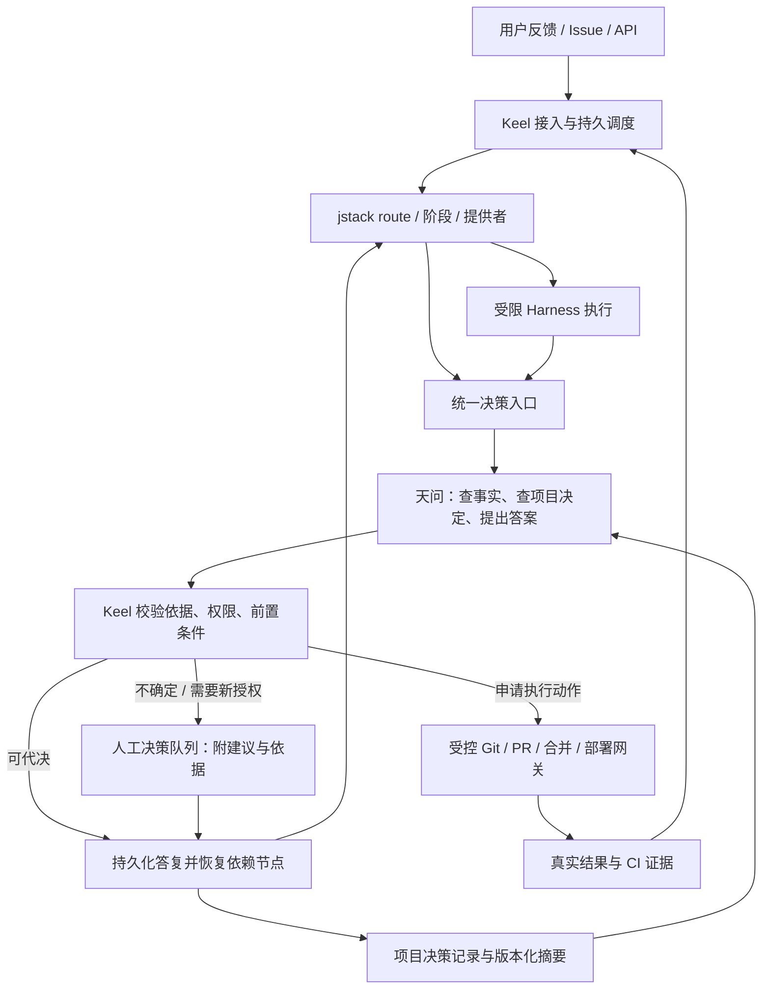

# jstack 主工作流与天问代理决策：生产方案

**日期**：2026-11-10
**状态**：生产目标设计；JT-01 只读影子协议与队列已实现，完整生产能力及真实模型验收仍未完成，见[实施进度](./implementation.md)。
**产品方向**：用户已明确 jstack 为个人核心工作流；Keel 主打后台、自动、少人工；任何原本要交给人的问题，先经过天问。技术契约和默认参数为本方案建议值。

配套材料：[接口与一致性](./contracts.md)、[交付与上线](./delivery.md)、[验收场景](./acceptance.md)、[ADR-0011](../../adr/0011-jstack-tianwen-runtime.md)。现有行为仍以代码和现有架构文档为准；本目录描述待实现行为。

## 1. 产品契约

Keel 在后台运行 jstack。天问是按项目理解用户目标、偏好和既有决定的代理，可以在用户授予的范围内代答、取舍和批准；不确定时先查证，仍无法可靠决定或取得必要授权时，才升级用户。

必须同时实现：

1. **jstack 是一等工作流**：阶段、路线、提供者、门禁来自 jstack，版本随任务固定。不能仅在现有 Developer 提示词中提到 jstack 就宣称完成集成。
2. **100% 人工请求先进入天问**：澄清、偏好、方案、拆票签核、评审分歧、must-stop、权限、预算和恢复决策均进入统一决策入口。命中不可代批的规则，天问也先形成建议，再交用户。
3. **代答可以直接恢复执行**：不是每次自动答案再由用户确认。具备适用依据、权限与合格证据的答案经 Keel 校验后生效。
4. **独立工作继续运行**：等待回答只阻塞依赖该答案的节点；进程、机器和会话退出不丢问题、不丢决定。
5. **可追溯、可纠正**：能解释用了哪个工作流、哪版项目摘要、哪些决策和哪项授权；人可覆盖答案、撤销规则、暂停或接管。

## 2. 职责与运行拓扑

| 组件 | 职责 | 边界 |
|---|---|---|
| jstack | 任务分级、路线、阶段行为、验证/评审/归档门禁 | 不在 Keel 之外再维护一个权威任务状态库 |
| Keel Control | 持久任务图、运行尝试、租约、策略、预算、决策接纳、副作用与恢复 | 控制函数可确定性重放；LLM 由 Execution Plane 执行 |
| 天问 | 代表用户理解问题、检查历史决定和当前证据、作出取舍或说明缺口 | 是 Execution Plane 角色，只提交 Proposal；不能写事实、签发权限或冒充人工 |
| 项目记忆整理器 | 从原始记录生成有来源的摘要候选、检查与发布版本 | 不改角色职责，不生成新授权，不提升推断的权威等级 |
| Harness | 执行 jstack 阶段、工具调用、上报提案和证据 | 不持有生产凭据；不直接调用外部人工渠道或绕过决策网关 |
| 人工队列 | 汇总天问无法解决的决定，收集用户答复 | 不是所有操作的逐次确认界面；支持批量和持久授权 |

首个生产版本使用 **PostgreSQL + Keel 常驻服务 + 受限执行进程**。队列、租约、全文/关键词检索均先用 PostgreSQL；不引入新的向量库、消息中间件或模型训练平台。向量检索只有在相关决策召回的实际评测不足时才增加。

## 3. jstack 如何成为主工作流

### 3.1 工作流定义由 jstack 发布

jstack 增加机器可读的、带协议版本与内容摘要的工作流导出。来源仍是其 `stages.md`、路由规则、provider、must-stop 和仓库级配置；导出器负责把它们组成一致包，避免 Keel 维护第二份阶段表。

任务绑定 `workflow_id=jstack`、工作流包摘要、仓库配置版本及基线 commit。工作流包保存阶段定义、provider 的内容与依赖、门禁版本和结果 schema。后台升级 jstack 不改变进行中任务；人工显式迁移才换版本，并先检查恢复兼容性。

工作流路线使用 jstack 的 size/clarify/plan/execute/verify/review/land/archive：XS/S 可简化，L/XL 按 ticket 依赖展开。jstack 路由提出任务图，Keel 确定性检查引用、依赖、循环和必需门禁后提交。任务图变更留版本，执行过的节点不被悄悄重写。

### 3.2 Managed 模式

jstack 保留交互式工作方式，新增由 Keel 驱动的 managed 模式：

- `request_decision()` 是所有人类交互的唯一抽象；现有 AskUser、终端输入、`stage.sh ask`、hooks/扩展的人工等待都转成持久请求。
- 每个阶段只做当前节点工作。provider 如果已完成验证或评审，提交可验证的证据，后续门禁复用证据；不能仅凭“已做完”跳过。
- pstack 的嵌套执行、开 PR、archive 的关票和清 worktree 也声明能力和动作，由 Keel 接纳、去重并执行。`land` 只有一个副作用拥有者。
- managed 模式下缺 provider、缺协议适配、配置校验失败或缺门禁能力，启动期明确拒绝；不悄悄退到交互等待或默认流程。
- 不可变工作流包是可信代码；目标仓库的 Issue、注释和普通文档是待解释数据，不能据此增加权限。

### 3.3 兼容现有 Keel

当前固定的 PM → RFC → Developer → QA → Review 状态机作为 `legacy-v01` 保留给既有任务。新 jstack 任务使用版本化阶段实例和任务图，不把所有 jstack 阶段挤进 `S-DEVELOPING`，也不并行运行两套主编排。

首发采用 expand–contract：新增运行模型和统一结果投影，旧任务走旧驱动；查询与控制台能区分二者。旧任务不自动迁移。旧 `S-*` 表和迁移不能因设计文档新增而提前改写，实际改动须同步数据库、schema、代码和 C1–C4 检查。

## 4. 天问如何代表用户

### 4.1 回答顺序

1. 接收结构化问题、选项、阻塞范围、当前执行意图与缺失信息。
2. 装入固定角色职责、用户明确的长期偏好、**本项目**当前摘要、任务内最新明确指令和授权描述。用户级偏好只含明确声明为跨项目的内容。
3. 能通过代码、文档、工具行为或当前环境查明的事实先查明；不让历史偏好替代当前事实。
4. 直接应用仍有效且适用范围一致的决定；摘要不足时，按主题检索少量原始记录和摘要水位之后的增量。
5. 没有直接先例时，允许在授权内采取低影响、可逆、有验证与回退方式的默认选择。保存假设与撤销办法，不伪称用户曾经决定过。
6. 对高影响或有竞争方案的决策，用一次独立复核检查适用条件和遗漏；不同模型赞同只算辅助证据，不产生授权。
7. 提交答案、来源、假设、证据等级和授权引用；Keel 接纳后自动继续。否则提交具体缺口、推荐项和可供用户选择的备选项。

### 4.2 接纳由证据和授权共同决定

模型自评“95% 确信”不作为放行条件。采用可检查的证据等级：

| 等级 | 判据 | 接纳方式 |
|---|---|---|
| E3：明确 | 当前有效的人类决定/任务指令明确覆盖当前问题；或经过验证的事实直接确定答案 | 匹配权限和前置条件后代答 |
| E2：有依据 | 有相关决定/事实，无未解决冲突，假设可列出且可检查 | 在授权影响范围内代决；高影响增加独立复核 |
| E1：默认选择 | 没有先例，但选择可逆、范围受限、有验证与回退方式 | 仅在允许默认决策的授权内自动采用，标为临时默认 |
| E0：不足 | 冲突未解决、关键事实不可得、关键偏好无法推定，或来源不可信 | 补一次有界查证后升级人工 |

“不能确定是否获授权”也是缺口。天问可以就缺少的授权给出建议；它的确信程度不会扩大授权。

### 4.3 授权是可复用的范围，不是每次确认

每项目有用户确认的 `DelegationPolicy`：允许哪些决定/动作、作用对象、环境、影响上限、预算、前置条件、有效期与必须人工的例外。范围足够明确时，同类后续决定不再问用户。

| 类别 | 建议初始范围 | 天问的行为 |
|---|---|---|
| 需求与偏好 | 既有目标内的文案、界面习惯、测试策略、兼容的技术选择 | 应用先例或可逆默认，记录理由，自动继续 |
| 实现与返工 | 隔离工作区内修改/测试、已授权预算内修 CI、拆票与依赖安排 | 自动决定；复杂度高本身不是人工条件 |
| 开分支、推送任务分支、创建/更新 PR | 用户登记的目标仓库与分支范围、规定验证通过 | 由 Keel 网关自动执行 |
| 合并、部署、数据库变更、对外发布 | 初次默认需要授权；可事先授予带目标/证据/窗口/额度的常驻授权 | 有匹配授权即可代批；无匹配授权先给建议再提交人工 |
| 修改天问授权、导入新的跨项目规则、撤销审计限制 | 仅真实用户可批准 | 天问负责分析和起草，提交用户；不得自行扩权 |

上述为方案的启动模板，不代表本次聊天已授予任何仓库的生产部署、删数据或合并权限。上线时用户确认一次项目授权档案；可以批量确认相同策略，后续仅对确实超界的请求打断。

### 4.4 must-stop 的正式语义扩展

现有 jstack 的 must-stop 明确要求真实用户，不能通过假装“天问就是人”绕过。需要修改 jstack 协议与规则，把 managed 模式的必须停定义为：**先暂停该动作，取得决策服务的有效处置**。

处置分为：`delegated`（授权内由天问决定）、`owner_required`（天问整理后等用户）、`denied`（明确不允许）。原交互模式仍按原用户确认路径。规则新增或改为 `owner_required` 时优先生效；目标仓库只能追加限制，不能扩大管理员下发的授权。

所有类别在成为 `owner_required` 之前都必须经过天问的准备/分析；若模型不可用，也记录天问尝试失败和原因，然后升级，禁止静默绕路。紧急撤销、取消任务和停止系统由控制面立即生效，不等天问；它们是外部控制指令，后续扩大范围或恢复执行仍走同一决策入口。

## 5. 决策记录与项目摘要

### 5.1 原始记录永远是事实来源

本方案的“项目记忆”是 Fact Plane 中原始决定及其读模型的统称，不增加独立事实平面；摘要和检索索引都可以从原始记录重建。

保存原问题、选择、理由、项目/模块/环境范围、适用条件、决定者、依据和撤销/替代关系。区分：

- `human_confirmed`：经过身份验证的用户明确决定。
- `delegated`：天问在已有授权内的新决定。
- `inferred`：天问对已有事实/偏好的推导。
- `provisional`：可逆的临时默认，后续可纠正。
- `observed`：工具观察，不是产品偏好或授权。

决定的来源等级不会因为重复引用、被摘要收录或通过 CI 而提升。用户未纠正、未回复也不等于确认。成功执行只追加结果证据。

同项目下的明确适用条件决定优先级；先检查不可覆盖的授权限制，再处理有效的任务指令、项目决定和用户全局偏好。不同作用域的记录不能仅按时间“取最新”；冲突不能可靠消解时升级。

### 5.2 摘要是有版本的读模型

固定提示词只定义职责与边界。项目摘要是经过整理的事实材料，包含决策 ID、来源等级、适用条件、未决冲突、生成版本、模型版本及已覆盖的日志水位。

建议初始参数：每新增 20 条有效决定或每 6 小时生成候选；约 3,000 token 的项目摘要，单次决策总记忆预算约 8,000 token。数字为可调默认值，不是已经实测的容量保证。

- 从原始有效记录增量整理；定期从原始记录重建，避免“摘要的摘要”累积漂移。
- 人工覆盖、撤销和关键约束变更立即更新决策有效性与记忆 epoch；不等定时整理完成。
- 回答前追加摘要水位之后与问题相关的记录；必需约束放不下时转查证/升级，不能静默截断。
- 发布前校验引用、范围、替代关系和关键约束保留，并回放回归问题集；检查失败保留上一版。
- 原子切换摘要指针；可回滚摘要内容，但回滚不能复活已撤销决定或撤回新的强约束。
- 每次答案固定其摘要版本与原始来源。摘要过旧不必全部停机；通过增量记录补齐，无法补齐时升级相关问题。

### 5.3 多项目隔离

首个版本服务单一 owner 的多个项目；多租户不在本次实现范围。项目必须有稳定 `project_id`，项目可关联多个经管理员登记的仓库。所有请求、记录、检索、摘要、授权和缓存均带 project ID，SQL 必须按项目过滤。

跨项目复用只读明确确认的用户级偏好；不自动把 A 项目的产品决策、商业约束或生产权限带到 B。目标仓库不能通过文件内容声明自己属于另一个项目。

## 6. 后台可靠性与执行边界

### 6.1 等待与恢复

所有请求先落库再推入队列。阶段在等待决定时提交 checkpoint，释放 Harness 会话；答复生效后写恢复事件，重新调度依赖节点。能 resume 则恢复，否则按事实重建上下文；不依赖会话一直存活。

天问、执行器、摘要整理器使用持久队列，认领带租约和 fencing token；旧 worker 即使恢复也不能提交过期结果。失败用有界重试和退避；重试耗尽进入明确的人工/运维队列，不忙轮询、不自动批准。

人工问题按 project + 主题 + 前置条件去重、合批。人工答复后自动唤醒后台，无需用户再次运行 `run-task`。默认等待不自动批准，也不自动放弃；项目可明确配置提醒/取消期限。当前 24h 到期弃单不能直接继承为新工作流默认值。

### 6.2 答案不等于执行许可

答案接纳与动作执行之间，前置事实可能变化。执行网关必须检查当前授权版本/撤销 epoch、决定有效性、请求版本、任务控制模式、目标资源与 SHA、环境和预算，并签发短期、绑定具体动作的执行许可。

模型只能提出动作。Git push、PR、merge、deploy 等凭据只在网关侧，执行沙箱不能通过 Bash/子 Agent/脚本直接获得它们。脚本和任意工具输出均不能替代该检查。

外部副作用采用 outbox + 幂等键 + 结果回查；不承诺数据库事务覆盖 GitHub/部署 API 的 exactly-once。超时且无法确认是否已生效时标记 `uncertain`，先回查，不能重复执行破坏性动作。

授权撤销立即阻止新的许可。已经发出的外部请求可能正在生效；网关必须报告这种边界，按动作能力尝试取消或补偿，不能保证撤销能逆转已完成的外部操作。

### 6.3 完成条件与运维

- verify/review/required CI 的证据绑定本次工作流节点和准确的 head SHA；代码变更使旧证据失效。未上报、超时或工具未运行不能算通过。
- `land=pr_ready` 时完成明确表示“PR 及必需 CI 通过”；`land=merged` 还需确认合并；`land=deployed` 还需环境健康检查。由用户在项目策略中选择，不能用同一个 DONE 模糊三者。
- daemon 管理接入、决策、执行、巡检、摘要和 outbox worker；角色异常可见、可重启。SIGTERM 停止认领，保存 checkpoint 或等待本阶段安全结束。
- 暂停/人工接管、预算耗尽、凭据失效和模型不可用有不同原因码。基础设施故障先自动修复/退避，再按严重度向用户报告，不能让天问拿猜测顶替工具结果。
- PostgreSQL 是持久真相；工作流包和 checkpoint/blob 必须纳入一致性备份并演练恢复。

## 7. 可观察性和生产准入

每个问题能回答：谁提出、天问用了哪些材料、为什么能代答、哪项授权允许、用了多少资源、何时恢复、最后谁改变了决定。

至少观测：人工请求经过天问的覆盖率、代答覆盖率、人工推翻率、越权拒绝数、冲突/过期依据拒绝数、重复执行数、决策延迟、等待积压、项目级成本和后台恢复时间。**覆盖率不能以减少升级、隐藏不确定性或放宽验证来优化。**

建议的首发验收目标：决策入口覆盖率 100%；结构化代答的授权与有效性检查覆盖率 100%；自动化验收中的跨项目污染、过期批准生效、重复破坏性动作均为 0。实测错误不能用“总体成功率高”掩盖。

质量评测分成两类：确定性故障/权限/恢复场景必须全过；模型判断用留出问题、原始人类答复与真实运行评审，不由天问自评。样本量、项目分布、风险范围和错误分类随报告发布；无足够样本时不宣称生产正确率。

上线先在影子模式回放，再对少量代表性项目启用已授权范围内的自动决策。生产启用要求本文档、[交付清单](./delivery.md)和[验收场景](./acceptance.md)的必需项全部完成；只完成提示词或后台启动脚本不算交付。

## 8. 当前代码与目标设计的差距

| 现有基础 | 缺口 |
|---|---|
| Event/Artifact、Task/Run、数据库角色、真实 PR/CI | 项目级决策记录/索引、原始决定与摘要版本、天问 Actor 尚未实现 |
| poller、timer-worker、孤儿巡检、并发上限 | 没有完整后台恢复链；单实例锁不是阶段租约或旧 worker 围栏 |
| `decide` / `answer` | 当前人工来源不能用于天问；缺统一请求 ID、问题结构、授权范围与答复事件 |
| ContextBuilder | 无项目决策摘要和按需历史检索配方；required 上下文不能悄悄丢弃 |
| jstack route、stage 记录和 harness gates | 没有统一 DecisionProvider，也没有工作流导出/managed 协议；当前 must-stop 仍要求真人 |
| Keel 开发规范已使用 jstack | 尚不等于 Keel 产品在后台运行 jstack |

本方案描述完整目标接口；目前只有[实施进度](./implementation.md)列出的 JT-01 接口可用，其余示例不得当作当前命令。
